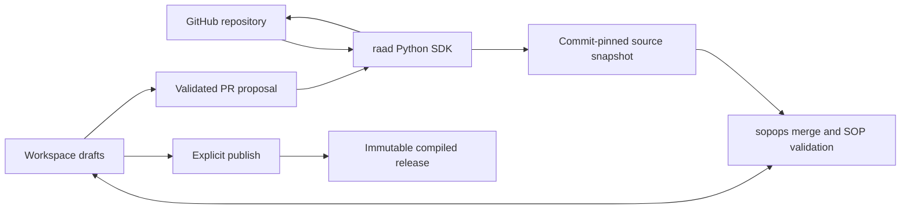

# Using raad for sopops’s GitHub integration

**Design proposal. No integration changes have been implemented.**

raad can replace sopops’s Git download, cache, and proposal plumbing. It cannot yet replace the whole GitHub integration without losing onboarding and PR behavior. Start with reads, keep sopops’s draft and publishing model, and close the write gaps before switching writes.

The main gaps are:

1. **Create and repair:** raad cannot propose against a missing folder or an invalid upstream revision.
2. **Keep one PR:** sopops updates a persistent sync PR; raad always creates a proposal branch and PR.
3. **Protect concurrent edits:** sopops needs an atomic check that the connection and drafts still match the inputs used to compute a sync.
4. **Recover reliably:** webhook delivery records, background jobs, and remote writes need recoverable states.
5. **Make adoption practical:** bulk snapshot reads, useful diagnostics, released Python wheels, and Git in the sopops image are still needed.

## Scope and evidence

This review compares raad at `c53249e2fbb4dac51cb3b0bd0bcfd5a8ed202dea` with sopops at `5b919d8b2b2c83efa30eb5022376c2878e8f7a08`. Findings describe these revisions; later changes need a fresh check. sopops was inspected read-only.

The review covered connection and App credentials, onboarding, repository reads and writes, merge/conflict handling, suggestions, webhook delivery, polling, releases, the repository UI, container packaging, and GitHub tests. See the [source index](#source-index).

Local Git fixtures and a loopback mock GitHub API reproduced raad’s create/repair failures. An isolated execution of sopops’s actual `reconcile` function reproduced the delayed-delivery merge outcome. Other race and recovery findings are code-based risks, not reproduced production incidents. No live private-repository writes or full sopops deployment tests were performed.

## What stays in sopops

People currently edit drafts, sync GitHub changes into them, send differences for review, and publish separately. Merging a PR does not publish a release. Preserve this behavior during the transport migration.

| Responsibility | Owner |
| --- | --- |
| App installation, repository picker, PAT encryption, token minting | sopops |
| Scoped Git fetch, validated local revisions, cache recovery | raad |
| SOP compilation, structured compiler issues, legacy config mapping | sopops and `sop` |
| Drafts, three-way merge, conflicts, suggestions, onboarding | sopops |
| Branch/commit/PR transport and concurrency checks | raad, after the proposed write additions |
| Durable sync jobs, workspace authorization, delivery deduplication | sopops |
| Immutable compiled releases and serving published instructions | sopops |

Use `AsyncRepository` inside FastAPI. The Python SDK embeds the Rust core and runs native work in worker threads. The web UI continues to use sopops’s API; it does not receive repository tokens or need the Node SDK for this integration.

Pass an explicit token provider backed by the workspace’s stored PAT or App installation. Resolve it against the current connection and check its generation before use. Keep credential discovery for developer tools; server requests must use the selected workspace credential. Store cache data in an explicit, writable directory scoped to the tenant and connection. A mount’s existing cache identity alone does not provide tenant isolation.

## Gaps in raad

### R1. A missing or invalid folder has no repair path — blocks onboarding

`propose` first checks the remote base SHA, then loads that SHA from the validated snapshot cache. A missing root never creates a snapshot. An invalid candidate is correctly rejected, so it also has no readable snapshot. Consequently, an otherwise valid fix cannot be proposed against either base. Using the old valid SHA instead fails the remote-head check.

This conflicts with sopops’s existing `inspect_project` and `read_head`, which support missing, invalid, and valid projects during onboarding. [raad write path][raad-writes], [sopops inspection][sopops-github]

Add a scoped **candidate inspection** API. It should return the observed commit, root existence, bounded file contents, and diagnostics without activating an invalid revision. A proposal may use an inspected candidate as its base, provided raad validates the complete resulting candidate and rechecks the remote head. Missing roots should be valid proposal bases for folder creation. Keep ordinary reads restricted to validated revisions.

An entirely empty repository has no base commit. Treat that as a separate, actionable setup state; creating the first repository commit needs an explicit bootstrap workflow.

### R2. Proposals cannot update or recover one persistent PR — blocks Send

raad creates `raad/<commit-prefix>` and then opens a PR. It exposes no PR lookup/status or update operation, caller operation identity, or no-change result. A failure after branch creation can leave a branch behind. The returned proposal has a URL but no structured PR number or state. [raad write path][raad-writes]

sopops’s Send action promises one PR that subsequent sends update. It also follows PRs opened by suggestions and onboarding. Retain that behavior rather than creating a new PR on every click.

Add proposal lookup, status, and safe update support. Distinguish:

- The expected **base branch SHA**, which protects against unseen upstream edits.
- The expected **proposal branch SHA**, which protects human or concurrent edits to the PR branch.
- An **operation ID**, which lets a retry discover an already-created branch, commit, or PR.

Use a branch scoped to a persistent connection ID, such as `sopops/<connection-id>/sync`. Preserve existing open PRs during migration and verify ownership before adopting their branches. Return `NoChanges` as a normal outcome. After ambiguous network failures, inspect remote state before retrying a write. GitHub and the application DB cannot share one atomic transaction; design for recovery rather than promising exactly-once execution.

### R3. File selection differs from sopops — blocks broad compatibility

sopops skips generated `build/` files, reads UTF-8 files, skips unsupported tree entries, and maps `sopc.yaml` to `sop.yaml` when the new name is absent. raad reads every mounted file and rejects symlinks, submodules, and LFS pointers. Its built-in JSON/YAML checks do not replace SOP compilation. [sopops folder reader][sopops-github], [raad collection][raad-store]

Introduce trusted include/exclude rules applied before fetching blobs and validating them; include the rules in cache identity. Keep legacy-name normalization in sopops with an explicit mapping back to raw Git paths. Preserve unsupported-entry rejection unless a deliberate exclusion makes the entry irrelevant. Exclusions must retain path and mount checks.

Define which files sopops owns before computing deletions. Ignoring generated output must not delete it from Git. Preserve unrelated files inside the mount unless a user explicitly removes them. A smaller mount already avoids sopops’s current recursive enumeration of the entire repository, which can hit GitHub’s truncated-tree response even when the selected folder is small.

The mount still limits API exposure rather than all Git downloads. Repository metadata and other objects can remain cached; retain the [documented isolation limits](architecture.md).

### R4. Importing a project requires repeated whole-snapshot reads — needed before default reads

The SDK offers `list` and individual `read` operations. Each read deserializes the whole stored snapshot, and status loads the active snapshot again. Reading every file therefore repeats work in proportion to project size. This is a code-derived performance concern, not a benchmark result. Pinning and reading are also separate operations, so another process could prune a revision between them. [raad reads][raad-store]

Expose a bounded bulk snapshot operation that acquires a retained revision under the cache lock and returns its files and provenance together. Provide a retention handle or atomic pin-and-read operation. sopops must retain its merge base and any revision needed by an unresolved conflict, independently of raad’s default retention count. Release builds already stored in sopops should survive cache removal.

### R5. Errors do not contain enough recovery information — needed for usable failure states

raad has typed SDK exceptions, but Git fetch failures are broad, REST 409/422 responses share one conflict category, rate-limit timing is a string, and custom validator failures do not expose SOP’s structured issues. The UI cannot reliably choose between reconnecting, waiting, fixing a file, or retrying a PR. [raad HTTP errors][raad-writes]

Add safe reason codes and structured metadata: provider status, retry timing with units, affected operation stage, observed SHA, and recoverable remote identifiers. Keep raw provider responses and tokens out of messages. Preserve the ambiguity of a private-repository 404 instead of claiming to know whether it is missing or inaccessible. SOP diagnostics should retain file, location, severity, and compiler code.

A long-running operation can outlive its installation token. Test expiry during fetch and PR creation. A bounded credential refresh may retry an authenticated read; a write with an uncertain outcome needs remote reconciliation first.

### R6. Packaging and provider support need an explicit contract

The Python package is not published. Current native CI covers Linux x86_64 and macOS arm64; it does not establish Linux arm64 or musl support. sopops’s runtime image has no Git installation, while its dependencies are hash-locked. [SDK distribution](../sdks/README.md), [sopops image][sopops-docker]

Release versioned wheels for deployment targets, pin them in sopops’s lockfile, install the supported Git version, and test the actual final image as its unprivileged user. Production should not need Rust or a compiler. Check Git, SDK, compiler, cache permissions, and cold-start errors in deployment tests.

raad hardcodes the GitHub.com Git remote. An API URL override is not complete GitHub Enterprise support, including GraphQL endpoints and browser URLs. sopops has a custom API-base setting, though parts of its integration also assume GitHub.com. Keep any Enterprise connections on the existing adapter until a tested provider configuration covers Git, REST, GraphQL, and web URLs. Do not silently move credentials between hosts.

### Proposed API contract

These names illustrate the required contract; they are **not existing SDK methods**. Implement shared semantics in Rust and keep the Python and TypeScript bindings consistent.

| Operation | Inputs and result |
| --- | --- |
| `inspect_candidate` | Resolve a branch or explicit SHA; return a scoped candidate reference, observed SHA, root existence, bounded files, and validation issues. Never activate an invalid candidate. |
| `acquire_snapshot` | Acquire a retained SHA and its provenance atomically. Read files in bulk or bounded chunks under that retention handle; release it explicitly. Never truncate silently or expand read limits implicitly. |
| `propose` extension | Accept a retained valid base or inspected candidate; validate the complete result. Return `NoChanges` or structured commit/branch/PR identity and operation progress. |
| `update_proposal` | Require operation identity, expected base SHA, and expected proposal head. Preserve human changes or report a conflict. |
| `proposal_status` / `recover_operation` | Find remote state after restart or a timeout, including closed/merged PRs and a branch created before PR creation failed. |

Keep these operations within the configured mount and permissions. Candidate inspection must not become an unvalidated application-read path. The host owns the decision to allow repair proposals and the SOP-specific validation of their resulting files.

In sopops, add a small source adapter used by `github.py` and `repo_sync.py`, then route onboarding and suggestions through it. Retain the current `/repo`, `/repo/project`, `/repo/sync`, `/repo/send`, and conflict endpoints. Extend their responses only where needed for freshness, diagnostics, and recoverable operation state. Discover the repository's default branch when connecting rather than assuming `main`, while preserving an explicitly selected branch.

## Sync edge cases in sopops

These deserve fixes even if the raad migration is deferred.

| ID | Trigger and current risk | Required behavior |
| --- | --- | --- |
| S1 | A delayed push delivery passes an older `payload.after` directly to `sync`. It can restore older content and move `pulled_sha` backward. | Treat events as reconciliation hints. Fetch the current configured branch head; permit an intentional force push, but fence stale jobs. |
| S2 | A draft edit, reconnect, or second sync happens while GitHub I/O runs. The merge uses earlier inputs; the draft write and connection-base update commit separately. | Compare connection generation, draft revision, and merge base in one transaction that applies drafts, conflicts, and sync metadata. Recompute on mismatch. |
| S3 | Upstream advances after `send` reconciles. `send` fetches a newer head and computes a full draft diff against it without reconciling that revision. | Propose against the exact reconciled SHA. If it moved, reconcile again before constructing the diff. Apply the same rule to suggestions. |
| S4 | Two workspaces use the same repository. Both force-update `sopops/sync`, including when they manage different folders. | Scope branches to connection identity. Check the expected PR branch head before updating. |
| S5 | The process exits after claiming a webhook but before executing its background task. A redelivery is deduplicated despite unfinished work. Some sync errors are caught and returned as normal results. | Persist pending work before acknowledging. Deduplicate successful work; resume pending or failed work. Keep attempts and next retry time. |
| S6 | Reading the old merge base returns a broad status 400. The code assumes a lost force-pushed commit and merges as an initial import. | Use a retained local base. Distinguish missing objects from authentication and other failures; never discard the base merely because a read failed. |
| S7 | A repository is renamed/transferred, a branch is deleted, or the workspace reconnects while work is running. Matching uses owner/name; deleted-branch pushes are skipped. | Store provider repository ID and connection generation. Revalidate access and canonical names. Show a missing-branch state and fence old work. |
| S8 | A webhook is missed or unrelated events continue arriving. Any matching event updates `webhook_at` and backs off polling. The settings page stops its periodic query once a webhook timestamp exists. | Run reconciliation independently of page activity; distinguish last delivery from last successful sync. Show freshness and next retry explicitly. |

Evidence: [sync, send, and polling][sopops-sync], [workspace write transaction][sopops-store], [webhook routing][sopops-webhooks], [delivery handling][sopops-deliveries], [repository UI][sopops-ui].

sopops does have workspace write locks. S2 concerns the lifetime of the earlier merge inputs and the separate metadata transaction. It also removes delivery claims on uncaught handler exceptions, allowing manual redelivery; S5 concerns process crashes and failures handled as normal results.

There is already a Hatchet reconciliation cron, defaulting to every 15 minutes, and a `pr-status` CLI for deployments without it. Preserve these; document which mechanism is enabled and test restart recovery. Do not assume every self-hosted deployment runs the worker. [Scheduled polling][sopops-jobs], [CLI polling][sopops-cli]

## Proposed sync flow

Keep these revisions separate:

| Value | Meaning |
| --- | --- |
| Observed upstream SHA | What the configured branch currently points to, including an invalid candidate |
| Validated source SHA | The latest source snapshot accepted by raad’s configured validation |
| Applied source SHA | The source snapshot used as sopops’s current three-way merge base |
| Draft revision | A version token covering all current workspace draft files |
| Release provenance | The source and compiler inputs for an immutable published build, when known |

A failed sync can leave the observed SHA ahead of the validated and applied SHAs. Local edits can make drafts differ from all three. A successful raad sync alone does not mean sopops applied the result or published it.

1. Verify the webhook signature. In one DB transaction, record the delivery and mark the connection dirty. Acknowledge after persistence, then process asynchronously. GitHub recommends responding within 10 seconds and using asynchronous processing; a redelivery retains its delivery ID. [GitHub webhook guidance](https://docs.github.com/en/webhooks/using-webhooks/best-practices-for-using-webhooks)
2. A worker acquires a per-connection lease with a fencing token. Record the connection generation, draft revision, and applied base. Coalesce duplicate triggers. Use the existing sopops DB for durable work; raad gains no service or database dependency.
3. Resolve the configured credential, sync the current branch, and retain both the old merge base and selected candidate. Obtain one immutable bulk snapshot. Normalize compiler inputs and compute their digest.
4. Compile the project, compute the three-way merge, and compile the resulting drafts. On failure, preserve existing drafts, merge base, and releases; record the rejected SHA and actionable diagnostics.
5. In one transaction, lock the connection and workspace, verify the fencing token, generation, draft revision, and applied base, then write file versions, conflicts, new base, job outcome, and a notification outbox entry. If inputs changed, discard the plan and recompute.
6. Deliver UI notifications after commit. Preserve all three conflict versions when advancing the merge base. Only release retained revisions when no conflict or pending operation needs them.
7. If another event arrived during processing, reconcile again. Poll independently of webhooks. A head check cannot prevent GitHub advancing immediately afterward; subsequent reconciliation provides convergence.

For Send, persist an operation record before remote work, including draft revision, base SHA, content digest, connection generation, expected proposal head, and operation ID. Recheck the connection before writing. Record the remote result afterward; recover an uncertain result by its identity. Disconnect fences local completion immediately, but cannot retract a remote request already in flight, so recovery must track that outcome too.

Do not use commit ancestry or lexical SHA ordering to decide which job is newer: a force push may intentionally select an older commit. Order application work by connection generation and fencing token, and resolve the branch again.

## What developers and users should see

| Situation | Message and action |
| --- | --- |
| Repository connected, folder missing | “No SOP project in `sops/` yet.” Offer a setup PR. Keep existing drafts. |
| Invalid upstream project | Show the rejected commit and file issues. Offer a repair PR; identify the last successfully applied revision. |
| Only local drafts changed | Show unpublished changes and Send to GitHub. Do not label the drafts as identical to a Git commit. |
| Both sides edited a file | Show base, draft, and GitHub versions, with the existing conflict actions. |
| Upstream moved during Send | Reconcile again; require a decision if a conflict appears. |
| No differences to send | “Your drafts already match GitHub.” Treat it as success. |
| Write timed out after branch creation | Show “Checking whether the PR was created.” Recover the same operation before creating another. |
| Token expired, access removed, or App suspended | Show reconnect or restore-access guidance. Preserve drafts and published builds under the workspace’s access policy. |
| Rate limit or outage | Show last successful sync and scheduled retry. Keep the selected valid revision. |
| PR closed, merged, or edited by a person | Refresh provider state. Preserve human changes; reopen/create only through an explicit supported action. |
| Folder moved, branch missing, or cache corrupted | Show the specific state and recovery action. Do not silently reset drafts or change the configured root. |

## Publishing is a separate product decision

For the initial migration, retain manual publishing and DB-backed drafts. Existing releases contain file-version snapshots and compiled builds, with no Git provenance fields. A `pulled_sha` cannot identify a release that also contains local edits. [Release model][sopops-release]

If connected workspaces should require Git approval before publication, add that as an explicit mode later. Require the publishable files to match an approved, validated source snapshot. Record provider host and repository ID, root, source commit, normalized project digest, normalization policy version, compiler version, and build digest. Mark legacy or mixed-source releases honestly. Do not make merging automatically publish as a side effect of replacing the transport.

## Implementation order and release gates

| Slice | Work | Gate |
| --- | --- | --- |
| 1. Protect current sync | Fix S1–S5; add connection generations, draft compare-and-swap, durable delivery/job states, and scoped branch ownership. | Controlled concurrency, delayed delivery, and crash tests pass on the existing adapter. |
| 2. Prepare raad reads | Add R3–R6 features needed by deployment: projection, bulk retained reads, diagnostics, wheels, image checks. | Same project digest as the old reader at the same SHA; supported deployment targets pass. |
| 3. Shadow, then switch reads | Compare readers without applying shadow results. Enable raad per workspace after parity checks. | Public/private PAT/App reads, legacy names, generated files, invalid updates, and retained bases work. |
| 4. Prepare and switch writes | Implement R1–R2, then migrate onboarding, Send, and suggestion proposals. | Missing/invalid-folder repair, stable PR updates, no-op sends, branch-head conflicts, and uncertain-write recovery pass. |
| 5. Optional publish policy | Add explicit Git approval requirements and release provenance. | Product decision accepted; mixed drafts cannot bypass the chosen publish rule. |

Keep a per-connection adapter choice during rollout. Preserve drafts, conflicts, releases, and source identity on rollback. Fence pending work before changing adapters and enable only one writer. Do not silently fall back to the old writer after an ambiguous raad write.

### Tests to add

The reviewed GitHub tests cover normal reads/writes, validation, conflicts, App events, delivery deduplication, and polling. Add fault-controlled tests for these boundaries:

- Deliver B then A, duplicate B, and force-push back to A. Apply the branch’s current state while rejecting stale job completions.
- Edit a draft, resolve a conflict, disconnect, or reconnect while a fetch is paused. Stale plans must fail the compare-and-swap check.
- Advance the base branch between reconcile and Send. Assert unseen changes are preserved.
- Send from two workspaces using one repository, with the same and different roots. Assert independent branch ownership.
- Crash after delivery persistence, after remote commit, after branch update, after PR creation, and before DB result recording. Resume or discover each operation without duplicate PRs.
- Create a missing folder; repair invalid JSON and invalid SOP semantics; handle an empty repository separately.
- Close, merge, squash, retarget, or manually update the PR. Verify state recovery and expected-head protection.
- Expire an installation token, revoke access, hit rate limits, and lose the network during each remote stage. Check redaction and retry behavior.
- Prune or corrupt the cache, lose the old remote base, and exhaust disk space. Preserve drafts and release artifacts; recover or explain why manual recovery is needed.
- Rename/transfer the repository, delete/recreate the base branch, move the folder, and include generated or unsupported files. No silent source switching.
- Install the wheel and Git in the final container; test writable cache permissions, restart persistence, and polling with and without Hatchet.

### Checks performed for this review

| Probe | Result |
| --- | --- |
| Mount a local Git-backed mock GitHub repository whose configured folder is absent; sync, then propose the folder at the current SHA | `not_found`, then `cache_miss`; only a GET reached the mock API, with no write requests |
| Sync valid JSON at A, commit invalid JSON at B, then propose corrected JSON against B | `validation`, then `cache_miss`; A remains active |
| Run sopops’s extracted `reconcile` with base=draft=`old`, upstream=`new`; then base=draft=`new`, upstream=`old` | First plan writes `new`; delayed plan writes `old` without conflicts. This proves the merge outcome; webhook ordering is established by source inspection. |

These probes used local fixtures, not GitHub credentials. This document does not claim that the proposed APIs, end-to-end migration, private write recovery, or concurrency fixes have been implemented or verified.

## Source index

All repository links below pin the reviewed revisions.

- [raad GitHub writes and errors][raad-writes]
- [raad snapshot collection, reads, retention, and locking][raad-store]
- [sopops connection, inspection, folder reading, and proposals][sopops-github]
- [sopops sync, Send, conflicts, and polling][sopops-sync]
- [sopops workspace write and publish transactions][sopops-store]
- [sopops webhook routing][sopops-webhooks] and [delivery handling][sopops-deliveries]
- [sopops repository UI][sopops-ui], [release model][sopops-release], and [runtime image][sopops-docker]
- [sopops scheduled polling][sopops-jobs] and [CLI fallback][sopops-cli]
- [Existing GitHub tests](https://github.com/sopops-dev/sopops/blob/5b919d8b2b2c83efa30eb5022376c2878e8f7a08/tests/test_github.py) and [App/sync tests](https://github.com/sopops-dev/sopops/blob/5b919d8b2b2c83efa30eb5022376c2878e8f7a08/tests/test_github_app.py)

[raad-writes]: https://github.com/amanmibra/raad/blob/c53249e2fbb4dac51cb3b0bd0bcfd5a8ed202dea/src/github.rs#L163
[raad-store]: https://github.com/amanmibra/raad/blob/c53249e2fbb4dac51cb3b0bd0bcfd5a8ed202dea/src/store.rs#L383
[sopops-github]: https://github.com/sopops-dev/sopops/blob/5b919d8b2b2c83efa30eb5022376c2878e8f7a08/src/sopops_server/github.py#L238
[sopops-sync]: https://github.com/sopops-dev/sopops/blob/5b919d8b2b2c83efa30eb5022376c2878e8f7a08/src/sopops_server/repo_sync.py#L106
[sopops-store]: https://github.com/sopops-dev/sopops/blob/5b919d8b2b2c83efa30eb5022376c2878e8f7a08/src/sopops_server/store.py#L616
[sopops-webhooks]: https://github.com/sopops-dev/sopops/blob/5b919d8b2b2c83efa30eb5022376c2878e8f7a08/src/sopops_server/github_webhooks.py#L47
[sopops-deliveries]: https://github.com/sopops-dev/sopops/blob/5b919d8b2b2c83efa30eb5022376c2878e8f7a08/src/sopops_server/api/github.py#L97
[sopops-ui]: https://github.com/sopops-dev/sopops/blob/5b919d8b2b2c83efa30eb5022376c2878e8f7a08/web/src/components/repo.tsx
[sopops-release]: https://github.com/sopops-dev/sopops/blob/5b919d8b2b2c83efa30eb5022376c2878e8f7a08/src/sopops_server/orm/releases.py
[sopops-docker]: https://github.com/sopops-dev/sopops/blob/5b919d8b2b2c83efa30eb5022376c2878e8f7a08/Dockerfile
[sopops-jobs]: https://github.com/sopops-dev/sopops/blob/5b919d8b2b2c83efa30eb5022376c2878e8f7a08/src/sopops_server/jobs/hatchet.py#L212
[sopops-cli]: https://github.com/sopops-dev/sopops/blob/5b919d8b2b2c83efa30eb5022376c2878e8f7a08/src/sopops_server/cli.py#L166
